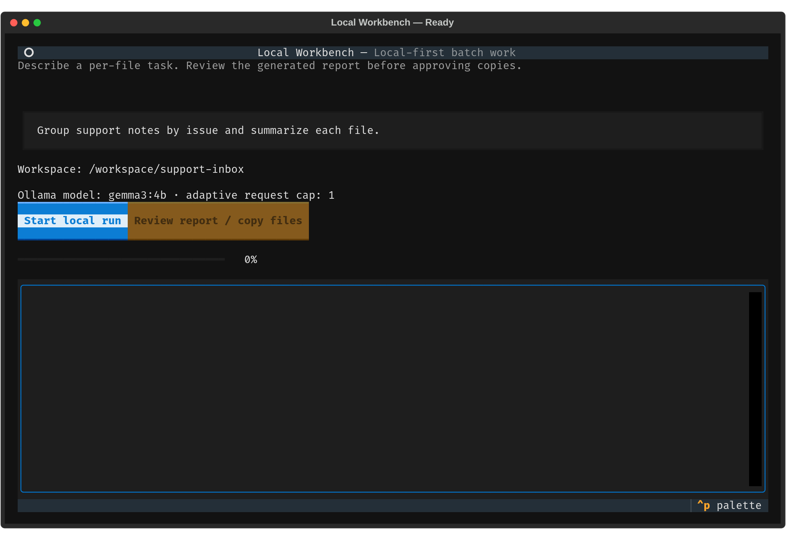
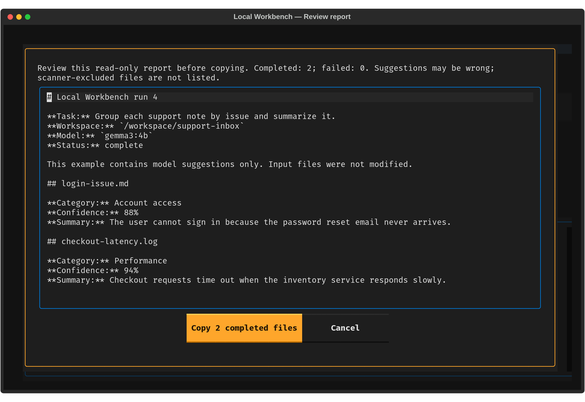

# Local Workbench

Local Workbench turns one natural-language instruction into a resumable batch of **per-file analysis jobs**. Choose your own criteria; a local Ollama model applies them to supported text files, images, or a mixed folder. Each file gets a category, summary, confidence score, and optional notes, followed by a report you can review and optional category-based copies.

Its breadth comes from the task you describe—not a menu of fixed classifiers. Its scope is intentionally narrower than an autonomous computer agent: it analyzes files and can copy categorized results after approval, but cannot choose arbitrary tools or perform unrelated computer actions.

The same instruction is applied independently to each file. It does not combine evidence across files or decide what should happen next based on earlier results.

## Screenshots

The screens below show the TUI and the read-only report review step. The report uses illustrative sample data.





## What kinds of work fit?

Give it the rubric in natural language and, if useful, preferred category labels; otherwise the model proposes a label per file. Example tasks:

| Work pattern | Example instruction |
| --- | --- |
| **Classify by your criteria** | “Group these support notes by their main issue; summarize each note.” |
| **Triage against a rule** | “Mark logs that show database timeouts as `investigate`; mark the rest `other`; include the relevant evidence.” |
| **Describe and sort images** | “Separate photos of a single dog from crowded dog scenes; label unrelated images `ignore`.” |
| **Summarize technical material** | “For each Markdown design note, identify the component and summarize the main decision.” |
| **Find key facts in a file** | “For each receipt image, report the vendor, date, and total in its summary; flag anything unreadable.” |
| **Create reviewable category folders** | “Label each screenshot by the product area it shows.” After reviewing the report, approve copies organized by the model’s category labels. |

These are examples of **per-file analysis**, not guarantees that the model will be correct. Fact extraction appears as ordinary report text; the app does not create custom columns, calculate across rows, or verify facts against external sources.

## How a run works

1. Choose a workspace folder and describe the task once.
2. The scanner selects supported files; each is analyzed independently by Ollama and saved as a durable job.
3. Local Workbench writes a Markdown report with each file’s category, confidence, summary, and any failure.
4. Inspect the report in the TUI. Only after your approval does it copy completed files into category folders. Originals stay in place.

The queue can resume interrupted work and retry failed files. Request concurrency is bounded and adapts to system-memory and CPU-pressure heuristics; it does not inspect GPU memory.

### Supported inputs and limits

- **Text:** `.md`, `.txt`, `.csv`, `.tsv`, `.json`, `.yaml`, `.yml`, `.xml`, `.html`, `.log`, `.ini`, `.toml`, `.py`.
- **Images:** `.png`, `.jpg`, `.jpeg`, `.webp`, `.bmp`; the selected model must support vision.
- CSV and TSV are analyzed as text files, not queried row by row. Each run scans at most 1,000 files; files over 8 MiB are skipped and text is capped at 32,000 characters per file.
- PDFs, spreadsheets, archives, audio/video, cross-file comparisons, custom structured exports, and arbitrary shell or desktop actions are outside the current scope.

## Quick start

Requirements: Python 3.11+, [Ollama](https://ollama.com/), and a model that supports structured output (and vision, for images).

```bash
git clone https://github.com/sujan-reddy-p/local-workbench.git
cd local-workbench
python -m venv .venv
. .venv/bin/activate
python -m pip install .
ollama pull gemma3:4b
local-workbench --workspace ~/Documents
```

Ensure the Ollama server is running first (if your install does not start it automatically, run `ollama serve` in another terminal). The TUI accepts a natural-language task. To run without the TUI:

```bash
local-workbench --workspace ~/Documents \
  --task 'Group feedback notes by issue and summarize each note' \
  --parallel 1
```

Use `--resume RUN_ID` to continue an interrupted run. `local-workbench --check` checks the Ollama connection and model availability.

## Privacy and file safety

- The app connects only to an HTTP Ollama endpoint on loopback (default `127.0.0.1:11434`); it does not call a cloud API directly.
- Known Ollama cloud model tags are rejected. **Loopback alone does not guarantee local inference:** Ollama can route cloud models through its server, and custom model aliases may hide their backing model. For sensitive files, verify the selected model is local and disable Ollama cloud features.
- The model receives no shell, network, or file-write tools. The app treats its output as an untrusted suggestion.
- Source files are read-only. Applying results makes copies only, never overwrites existing exports, and requires explicit approval.
- SQLite stores job metadata and suggestions, not source contents by design. Reports can contain paths and summaries; approved exports contain file copies. Keep the state directory private if that data is sensitive.

Reports and exports are stored under `~/.local/share/local-workbench/` by default. Override this with `--state-dir`.

## Development

```bash
python -m pip install -e '.[dev]'
ruff check local_workbench tests
pytest
python -m build
```

## License

MIT. See [LICENSE](LICENSE).
